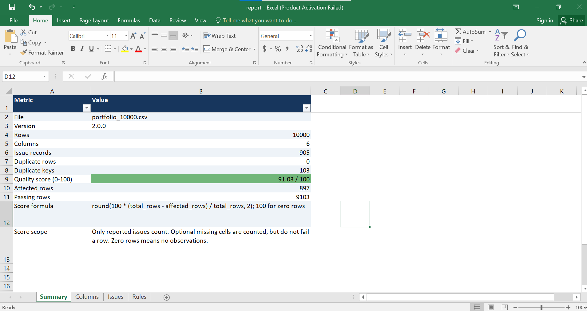

# CSV Data Quality Auditor — Version 2

A read-only Python CLI demonstrated and tested with synthetic records. V2 preserves existing CLI flags, CSV issue columns, JSON metrics, and Markdown reporting. It adds JSON validation rules, exact date validation, allowed-value checks, a transparent quality score, and a formatted Excel workbook. Saved reports in `example_output/` remain the original V1 examples.
## Example Audit Report

The following Excel report was generated using a fully synthetic dataset containing 10,000 records.



### Demonstration Results

- **10,000** records audited
- **905** validation issues identified
- **897** affected records
- **91.03/100** configured-rule compliance score
- **24 automated tests passed**

The quality score measures compliance with configured validation rules, not absolute data correctness.

---

## Installation

Requires Python **3.10+**. `openpyxl` is the only direct dependency; it installs `et-xmlfile` automatically. No pandas, database, or Microsoft Excel installation is required.

```bash
python -m venv .venv
# Windows PowerShell:
.venv\Scripts\Activate.ps1
# macOS / Linux instead:
# source .venv/bin/activate
python -m pip install -r requirements.txt
```

On Windows, use `py -3` in place of `python` to create the environment if needed. Activation is optional: use `.venv\Scripts\python.exe` on Windows or `.venv/bin/python` elsewhere.

## CLI examples

The original flags still work. Choose a new output directory to preserve existing reports:

```bash
python audit.py sample_data/customers.csv --required customer_id name email --unique customer_id --numeric amount --output output_v2
python audit.py sample_data/customers.csv --config rules.example.json --output output_v2
python audit.py --help
python audit.py --version
```

An included V2 synthetic example exercises every validation category:

```bash
python audit.py examples/v2_synthetic.csv --config examples/v2_rules.json --output example_output_v2
```

Its four generated reports are in `example_output_v2/`: six records, 13 issue records, four affected records, and a score of 33.33/100.

For the portfolio demonstration, `examples/portfolio_10000.csv` contains **10,000 entirely synthetic account records**, with fixed-seed injected defects. No records were copied from real people or organizations; all email addresses use `example.com` or an intentionally invalid placeholder.

```bash
python audit.py examples/portfolio_10000.csv --config examples/portfolio_rules.json --output portfolio_reports
```

The recorded run found **905 issues across 897 affected records**, scoring **91.03/100**. The final measured CLI subprocess took **1.459661 seconds** on the recorded Windows/Python environment, including startup and four report writes. This is one observed run, not a throughput guarantee. See [PORTFOLIO_DEMO.md](PORTFOLIO_DEMO.md) and [TEST_RESULTS.md](TEST_RESULTS.md).

To reproduce the dataset, time the existing CLI, and verify every generated report using openpyxl:

```bash
python scripts/run_portfolio_demo.py
```

The support script checks existing demo dataset bytes rather than overwriting them, refreshes only `portfolio_reports/`, and records timing, environment, report hashes, and workbook checks in `portfolio_reports/verification.json`. Generation and verification are excluded from the CLI timing. Visual Excel rendering has **not** been verified.

For a synthetic CSV with additional `joined_on` and `status` columns, save this as `rules.json`:

```json
{
  "required": ["customer_id", "email", "joined_on"],
  "unique": ["customer_id"],
  "numeric": ["amount"],
  "dates": {"joined_on": "%Y-%m-%d"},
  "allowed_values": {"status": ["active", "inactive"]}
}
```

```bash
python audit.py synthetic_customers.csv --config rules.json --output audit_results
```

`rules.example.json` matches the existing sample headers. The expanded configuration above requires its own synthetic CSV with the additional columns.

## Validation rules

All keys are optional. Unknown keys, incorrect types, unsupported formats, and references to absent columns fail with a clear error. Configuration is a UTF-8 JSON object (BOM accepted). CLI `--required`, `--unique`, and `--numeric` lists are **added** to configured lists, removing repeated column names. Empty CLI lists do not clear configured rules.

| Rule | Behavior |
| --- | --- |
| `required` | Empty, whitespace-only, and absent cells generate `missing_required`. Missing counts include all columns, including optional ones. |
| `unique` | One composite key across listed columns. Later occurrences generate `duplicate_key`. Keys with any blank component are skipped. |
| `numeric` | Nonblank cells must parse as finite Python floats. Rejects NaN, infinity, overflow, currency symbols, and thousands separators. Negatives and scientific notation are valid. |
| `dates` | Map columns to exact calendar-date formats. Requires `%Y`, `%m`, `%d` once each with separators chosen from `-`, `/`, `.`, or spaces. Four-digit years, two-digit months/days, and real dates are required. Leap years are checked. |
| `allowed_values` | Map columns to lists of strings. Matching is case-sensitive. An empty list rejects every nonblank value. Use strings such as `"1"`, not JSON numbers. |

Cells are stripped of surrounding whitespace for numeric, date, allowed-value, email, and key checks. Configured allowed strings are used exactly as written. Blank cells skip these checks: add a column to `required` if a blank must fail. Headers are exact and case-sensitive.

Exact duplicate rows and extra fields are always reported. Row comparison uses original header-column values, including whitespace; extra fields are separately reported and excluded from that comparison. A column named `email` (case-insensitive) always receives the existing basic syntax check. No data is corrected or written back.

Python callers can keep using `audit_csv(path, required, unique, numeric)` and `write_reports(result, output)`. Supply new rules with `audit_csv(path, rules={...})`. Report generation requires openpyxl; auditing alone does not import it.

## Quality score

```text
affected_rows = distinct data records with at least one reported issue
passing_rows = total_rows - affected_rows
score = round(100 * passing_rows / total_rows, 2)
```

Each affected row counts once, even with several issues. Three rows with two issues on the first row score **66.67/100**. Optional missing cells are counted but do not generate issues or lower the score. Repeated rows/keys penalize the later occurrence, consistent with the issue list.

Header-only input scores **100** by convention with `total_rows = 0`; this means no observations, not evidence of good data. Empty files without headers are rejected. JSON, Markdown, and Excel disclose the formula and inputs. **The quality score measures configured rule compliance, not absolute data correctness.** It does not establish business correctness or validate against an inferred schema. Scores from different configurations are not directly comparable.

## Reports

Each successful run creates these files in `--output` (default `output`):

| File | Contents |
| --- | --- |
| `summary.json` | Existing metrics and issues, plus version, absolute source path, effective rules, date/allowed-value counts, score, passing rows, and affected rows. |
| `issues.csv` | Existing columns: `csv_line`, `column`, `issue`, `value`. One record per issue; one row can have several issues. |
| `report.md` | Counts, score formula and inputs, effective rules, validation totals, and notes. |
| `report.xlsx` | Summary, Columns, Issues, and Rules worksheets, with styled headings, alternating fills, filters, frozen headings, wrapping, sized columns, print settings, and a score color scale. Formula-like input is literal text. |

The legacy `csv_line` field is the **logical CSV record number**, with the header counted as 1. Quoted multiline fields or blank physical lines can make it differ from the physical file line. Excel labels it CSV record.

The CLI refuses report targets that coincide with the source or configuration, including existing hard links. The report API also protects the recorded source path. Existing reports in the selected directory are replaced; choose a new directory to retain older runs. Writes are not transactional: an I/O failure can leave a partial report set. Excel is rendered first so an unavailable dependency fails before writing text reports.

## Automated tests

```bash
python -m unittest discover -s tests -v
```

Tests use only temporary synthetic CSVs and configuration files. Coverage includes original behavior, missing values, duplicates, finite numerics, exact dates/leap years, allowed values, bad configurations, unknown columns, score edge cases, BOM/CRLF input, extra fields, CLI compatibility/errors, input preservation, report contents, and workbook formatting. Integration tests invoke the CLI and reload the workbook with openpyxl; they do not require Microsoft Excel.

See `TEST_RESULTS.md` for the executed checks, environment, and remaining verification limits.

## Limitations

- Input is UTF-8 comma-delimited CSV. Types and schemas are not inferred. The standard CSV reader is permissive about some malformed quoting.
- Data, duplicate sets, issues, and workbook contents are held in memory; large inputs need a streaming design.
- Numeric validation checks float parseability and finiteness, not decimal precision, ranges, or domain constraints.
- Email checks basic syntax, not deliverability. Unique columns form one combined constraint, not multiple independent indexes.
- Dates support calendar dates only, without timestamps or timezones. There is no custom severity, rule weighting, or automatic correction.
- Excel allows 1,048,576 rows per worksheet including headings and 32,767 characters per cell. Oversized exports fail explicitly. XML-incompatible control characters appear as literal `\xNN` escapes in Excel; CSV/JSON retain their values. Automated workbook checks do not substitute for manual review in every spreadsheet application.
- CSV issues preserve formula-like strings: import as text in spreadsheet software. XLSX explicitly stores these values as text.
- Reports contain offending values and the absolute source path; review them before sharing. Repository samples and automated test fixtures are synthetic.

The `.gitignore` excludes virtual environments, Python caches/bytecode, temporary files, `.env` files, and common credential/key files. Reviewed `.env.example` and `.env.template` files remain shareable. Ignore rules do not remove files already tracked by Git or prove that all secrets are absent; review the staged files and history before any public release.
